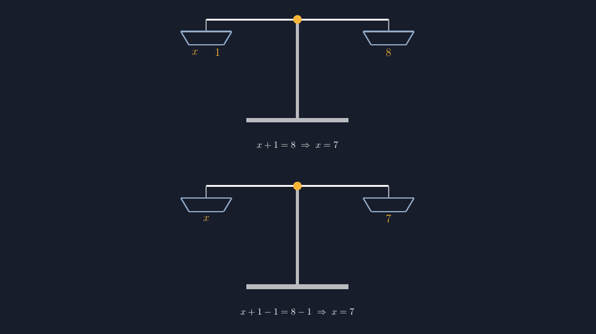

Bab persamaan linear selalu saya buka dengan pertanyaan yang sama: "kalau satu kantong misteri ditambah satu batu seberat satu gram, beratnya sama dengan delapan gram — berapa isi kantong itu?" Siswa kelas tujuh umumnya langsung menjawab tujuh. Yang membuat saya waswas justru bukan jawabannya, tapi gambar yang saya pakai untuk menunjukkannya. Dulu saya menggambar timbangan di papan tulis dengan garis yang miring dan lengan yang jelas-jelas tidak seimbang — sementara inti pelajarannya adalah *keseimbangan*.

<!--more-->

## Timbangan yang Bohong

Pernah ada satu momen yang membuat saya kapok. Waktu itu saya menggambar timbangan di papan, lalu menulis $x + 1$ di piringan kiri dan $8$ di piringan kanan. Seorang siswa yang biasanya pendiam mengangkat tangan: "Pak, kok timbangan kemiringannya ke kiri? Berarti $x + 1$-nya lebih berat, dong?" Saya tertegun. Dia benar secara penglihatan, dan papan tulis saya memang tidak bisa berbohong setengah-setengah. Kalau gambar bilang tidak seimbang sementara mulut saya bilang seimbang, mana yang akan diingat anak-anak?

Sejak itu saya percaya: model timbangan hanya boleh dipakai kalau gambarnya benar-benar seimbang. Dan seperti tulisan-tulisan saya sebelumnya tentang bidang koordinat, bangun datar, sampai diagram peluang, jawabannya kembali sama — TikZ.

## Dua Keadaan, Satu Kanvas

Gambar inti yang sekarang saya pakai menunjukkan dua keadaan sekaligus: timbangan sebelum dan sesudah "mengurangi satu batu di kedua piringan". Justru di sinilah letak sifat penting persamaan: jika kedua ruas diperlakukan sama, keseimbangan tidak berubah.

```latex
\begin{tikzpicture}[line width=1.4pt]
  % tiang, alas, lengan
  \draw[gray!60, line width=3pt] (0,2.6) -- (0,-1.15);
  \draw[gray!60, line width=5pt] (-1.9,-1.15) -- (1.9,-1.15);
  \draw[white, line width=2pt] (-3.4,2.6) -- (3.4,2.6);
  \fill[acc] (0,2.6) circle (0.16);
  % piringan kiri: blok "x" dan "1"
  \draw[dish] (-4.35,2.15) -- (-2.45,2.15)
           -- (-2.75,1.65) -- (-4.05,1.65) -- cycle;
  \node[acc] at (-3.82,1.37) {$x$};
  \node[acc] at (-2.98,1.37) {$1$};
  % piringan kanan: blok "8"
  \node[acc] at (3.4,1.37) {$8$};
  \node at (0,-2.1) {$x+1=8 \;\Rightarrow\; x=7$};
\end{tikzpicture}
```

Hasil render lengkapnya (dua keadaan, sebelum dan sesudah kedua ruas dikurangi 1):



*Timbangan tetap seimbang karena yang dikurangi sama: $x+1-1 = 8-1$.*

Detail teknisnya sederhana tapi menentukan. Lengan digambar sebagai segmen horizontal murni dari $(-3.4, 2.6)$ ke $(3.4, 2.6)$ — bukan garis yang saya "usahakan lurus" seperti di papan tulis. Kedua piringan digantung tepat di ujung lengan pada koordinat yang sama jaraknya dari titik tumpu, sehingga simetri keseimbangan itu bukan kesan, melainkan konsekuensi dari koordinat. Label $x$ dan $1$ saya tempatkan sebagai dua blok bertumpuk di piringan kiri, dan setelah "dikurangi satu", blok $1$ hilang dari kedua piringan sekaligus.

## Kenapa Persis "Dikurangi di Kedua Ruas"

Di kelas, gambar ini saya pakai untuk membedah pertanyaan yang sering mengganjal: kenapa saat menyelesaikan $x + 1 = 8$ kita boleh "pindahkan satu ke kanan jadi minus"? Jawabannya, itu hanya singkatan dari sesuatu yang secara geometri sangat wajar: kedua piringan sama-sama diturunkan bebannya satu batu. Timbangan tidak peduli kita mengurangi berat; ia hanya peduli kedua sisi berubah sama. Setelah blok $1$ diambil dari kedua sisi:

$$x + 1 - 1 = 8 - 1 \quad\Rightarrow\quad x = 7$$

Anak yang pernah *melihat* blok $1$ hilang dari dua piringan sekaligus tidak akan menganggap "pindah ruas berubah tanda" sebagai mantra gaib. Itu hanya catatan ringkas dari aksi yang sudah ia alami di gambar. Beberapa siswa bahkan mulai menyaingi: "Pak, kalau timbangan dikali dua di kedua sisi, tetap seimbang nggak?" — dan kita bisa langsung uji dengan gambar versi kedua. Persis pengalaman saya menulis soal berjenjang: satu gambar yang benar melahirkan pertanyaan lanjutan yang tidak saya rencanakan.

## Satu Model, Batasnya Juga Harus Dibicarakan

Saya tidak mengagung-agungkan model timbangan tanpa catatan. Model ini kuat untuk persamaan linear sederhana, tapi mulai goyah ketika muncul $x$ di kedua ruas — "timbangan dengan kantong misteri di dua piringan" masih bisa dibayangkan, tapi ketika koefisiennya pecahan, anak-anak lebih cepat pusing pada modelnya daripada pada aljabarnya. Makanya di LKPD saya selalu cantumkan satu kalimat: timbangan adalah **model pembuka**, bukan rumah permanen. Ia bertugas menanamkan intuisi bahwa persamaan adalah keseimbangan; setelah intuisi itu terbentuk, siswa harus berani meninggalkan timbangan dan bekerja langsung dengan simbol.

Yang menarik, batasan ini justru memicu diskusi paling hidup. Kelas lalu ada siswa yang bertanya kenapa soal di buku tidak pernah menggambar timbangan lagi kalau modelnya sebagus itu. Jawaban saya sederhana: karena buku menganggap kita sudah tumbuh dari model itu. Dan tumbuh dari sebuah model adalah tanda bahwa modelnya berhasil — bukan gagal.

## Tantangan Kecil untuk Rekan Guru

Dua hal kecil dari pengalaman saya. Pertama, jangan gambar piringan dengan ukuran berbeda antara timbangan pertama dan kedua — secara semiotika, ukuran piringan yang berubah akan terbaca sebagai "berat yang berubah", dan itu melawan pesan utama. Kedua, label di dalam piringan sebaiknya dites dulu posisinya; label yang menempel di lengan akan membuat gambar terasa salah meski siswa kesulitan menjelaskan kenapa. Dalam TikZ, saya menyelesaikannya dengan menurunkan koordinat label ke dalam "tubuh" piringan, bukan sekadar menaikkan piringannya.

> 📎 **Berkas TikZ lengkap:** [tikz-timbangan-persamaan-linear.tex](tex/tikz-timbangan-persamaan-linear.tex) — siap kompilasi (butuh paket `tikz`).

## Penutup: Keseimbangan Tidak Boleh Setengah-Setengah

Mengajarkan persamaan linear dengan timbangan yang miring itu seperti mengajarkan kejujuran sambil menyembunyikan sesuatu. Anak-anak tidak butuh penjelasan panjang tentang sifat kesamaan; mereka butuh melihat blok $1$ yang hilang dari kedua piringan sekaligus, dan percaya bahwa keseimbangan itu nyata — bukan sekadar kata kerja bantu di papan tulis.

TikZ membantu saya jujur di depan kelas, sekali lagi. Dan setiap kali gambar itu seimbang, ada satu siswa yang berhenti menghafal dan mulai mengerti.
