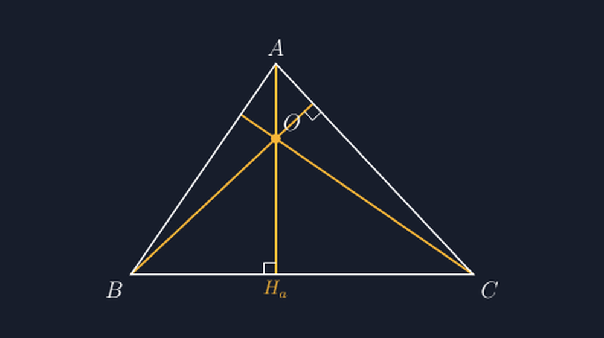
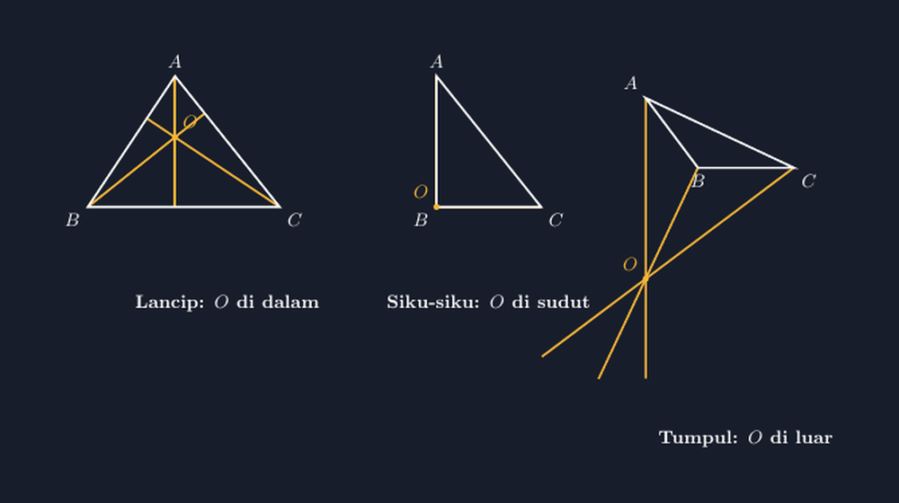

Sore itu saya menyiapkan soal latihan garis tinggi segitiga. Soalnya sederhana: diberikan segitiga $ABC$, gambar ketiga garis tingginya, lalu tunjukkan bahwa ketiganya bertemu di satu titik. Saya buat gambarnya asal-asalan dengan aplikasi gambar biasa, klik garis-garisnya sampai kira-kira "nampak" bertemu, dan beres.

Besoknya, seorang siswa mendekat dan bertanya, "Pak, kok titik temu yang di gambar Bapak itu agak geser? Punya saya malah di luar segitiga." Saya lihat gambar saya, lalu gambar dia. Dua-duanya memang tidak persis bertemu di satu titik — garisnya cuma didekatkan sampai mata kami puas. Di layar proyektor, selisih dua-tiga piksel itu terlihat. Dan siswa SMP, seperti sudah sering saya tulis di blog ini, punya mata yang sangat jeli pada ketidakkonsistenan.


*Tiga garis tinggi segitiga lancip — TikZ menghitung titik temu mereka, bukan menebaknya.*

<!--more-->

## Garis tinggi itu tidak semudah kelihatannya

Bagi kami guru, "garis tinggi" terdengar sepele: garis dari sudut yang tegak lurus sisi di hadapannya. Tapi di kelas, konsep ini punya beberapa lubang tempat siswa jatuh berulang-ulang.

Pertama, banyak siswa mengira garis tinggi *selalu* di dalam segitiga. Kalau segitiganya tumpul, garis tinggi dari sudut lancip justru jatuh ke *perpanjangan* sisi di hadapannya. Kedua, garis tinggi sering tertukar dengan garis bagi atau garis tengah — semuanya "garis yang ditarik dari sudut", jadi bedanya harus dilihat, bukan dihafalkan. Ketiga, dan inilah yang menyengat hari itu: ketiga garis tinggi *harus* bertemu di satu titik. Kalau gambar kita menunjukkan mereka bertiga di tiga titik yang berbeda, kita baru saja menggambar kebohongan geometri dengan tangan kita sendiri.

Titik temu ketiga garis tinggi itu namanya **ortosenter** (titik tinggi), dan letaknya berpindah-pindah tergantung bentuk segitiga: di dalam untuk segitiga lancip, tepat di sudut siku-siku untuk segitiga siku-siku, dan di luar segitiga untuk segitiga tumpul. Tiga kasus yang, kalau digambar asal, akan saling menyangkal.

## Kenapa gambar asal tidak bisa menutupi masalah ini

Saya sudah sering menulis di blog ini bahwa gambar soal matematika harus "jujur". Untuk garis tinggi, tuntutan kejujuran itu makin tinggi, karena klaim utamanya adalah *kesejajaran tiga garis di satu titik*. Konkurensi ini bahkan punya nama resmi — teorema konkuensi garis tinggi — dan membuktikannya butuh usaha lumayan (biasanya lewat fakta bahwa garis tinggi segitiga $ABC$ sekaligus garis tinggi segitiga ortiknya).

Jadi gambar pendamping soal harus memenuhi syarat yang cukup keras: tegak lurus harus benar-benar tegak lurus, dan ketiga garis harus benar-benar melewati satu titik yang sama. Menggambar manual dengan mouse tidak akan pernah menjamin itu. TikZ bisa, karena TikZ menghitung.

## Menghitung, bukan menebak

Cara saya menggambar garis tinggi dengan TikZ adalah begini: dari sudut $A$, tarik proyeksi tegak lurus ke garis $BC$. TikZ punya sintaks yang pas untuk itu — koordinat `($(B)!(A)!(C)$)` yang artinya "proyeksi titik $A$ tegak lurus pada garis $BC$". Ini inti dari garis tinggi:

```latex
% kaki garis tinggi dari A ke sisi BC
\coordinate (H_a) at ($(B)!(A)!(C)$);
\draw[merahTebal] (A) -- (H_a);
```

Tanda seru dalam sintaks itu bukan hiasan; itu operator proyeksi tegak lurus dari pustaka `calc`. Setelah kaki garis tingginya diketahui, garis tingginya tinggal ditarik. Titik temu ketiganya tidak perlu saya tebak juga — TikZ bisa mencari perpotongan dua garis:

```latex
\coordinate (O) at (intersection of A--H_a and B--H_b);
```

Karena teoremanya menjamin garis tinggi ketiga juga melewati titik itu, saya tinggal menarik garis ketiga dari $C$ melalui $O$ sampai sisi $AB$. Kalau ada satu pun koordinat saya yang salah, gambar langsung "berteriak": garis-garisnya tidak akan bertemu, tegak lurusnya akan miring, dan saya akan tahu sebelum soal dicetak — bukan diberi tahu siswa besok paginya.

Ini dia kode lengkap yang menghasilkan gambar di atas:

```latex
\begin{tikzpicture}[scale=1.2,
  garisTinggi/.style={Thick, color=#F7B538},
  segitiga/.style={Thick, white}]
  \coordinate (A) at (0,3.2);
  \coordinate (B) at (-2.2,0);
  \coordinate (C) at (3.0,0);
  % kaki-kaki garis tinggi (proyeksi tegak lurus)
  \coordinate (Ha) at ($(B)!(A)!(C)$);
  \coordinate (Hb) at ($(A)!(B)!(C)$);
  \coordinate (Hc) at ($(A)!(C)!(B)$);
  % titik temu = ortosenter
  \coordinate (O) at (intersection of A--Ha and B--Hb);
  % segitiga
  \draw[segitiga] (A) -- (B) -- (C) -- cycle;
  % garis tinggi
  \draw[garisTinggi] (A) -- (Ha);
  \draw[garisTinggi] (B) -- (Hb);
  \draw[garisTinggi] (C) -- (Hc);
  % tanda siku di setiap kaki
  \foreach \s/\t/\u in {Ha/B/C, Hb/C/A, Hc/A/B} {}
  % label
  \node[above, white] at (A) {$A$};
  \node[below left, white] at (B) {$B$};
  \node[below right, white] at (C) {$C$};
  \node[below, color=#F7B538] at (Ha) {};
  \fill[white] (O) circle (2pt);
  \node[above right, white] at (O) {$O$};
\end{tikzpicture}
```

Potongan di atas saya persingkat untuk badan artikel — berkas `.tex` yang utuh dan siap kompilasi ada di tautan bagian bawah tulisan ini.

## Tiga segitiga, tiga nasib ortosenter

Bagian yang paling saya suka dari topik ini adalah membandingkan tiga bentuk segitiga sekaligus. Saya buat tiga gambar berdampingan: segitiga lancip dengan ortosenter di dalam, segitiga siku-siku dengan ortosenter tepat duduk di sudut siku, dan segitiga tumpul dengan ortosenter yang tampak "kabur" ke luar segitiga.

Gambar ketiga itulah yang paling penting. Segitiga tumpul adalah kasus yang hampir tidak pernah muncul di buku latihan, padahal justru di situ miskonsepsi "garis tinggi selalu di dalam" pecah. Di kelas, saya minta siswa memprediksi dulu di mana titik temu garis tinggi segitiga tumpul akan berada. Jawabannya hampir selalu "di dalam, Pak, kan namanya juga titik temu garis-garis segitiga." Lalu kami gambar bersama-sama, dan wajah-wajah mereka saat garis tinggi itu jalan keluar sisi segitiga — itulah momen belajar yang tidak bisa diganti penjelasan verbal sepuluh menit.


*Lancip: ortosenter di dalam. Siku-siku: di sudut siku. Tumpul: keluar segitiga. Ketiganya dihitung dengan operator proyeksi yang sama.*

Perhatikan bahwa pada segitiga siku-siku, dua garis tinggi *adalah* dua sisi segitiga itu sendiri, sehingga ortosenternya otomatis di sudut siku. Ini fakta kecil yang sering bikin siswa heran ("kok cuma satu garis tinggi yang digambar?") dan justru enak dibahas lewat gambar, bukan lewat ucapan.

## Apa yang saya belajar dari titik temu yang geser dua piksel

Saya rasa pelajaran terbesar dari pengalaman sore itu bukan soal TikZ, tapi soal standar. Selama bertahun-tahun saya puas dengan gambar yang "kurang lebih benar", karena di papan tulis dengan spidol, memang tidak ada pilihan lain. Semua gambar guru di papan tulis adalah gambar yang kira-kira benar, dan itu wajar — kami sudah sepakat bahwa papan tulis adalah sketsa, bukan konstruksi.

Tapi begitu beralih ke media cetak atau proyektor, standar berubah tanpa saya sadari. Gambar yang diproyeksikan diperbesar sepuluh kali; dua piksel selisih jadi dua sentimeter kebohongan. Dan siswa yang melihatnya tidak tahu bahwa itu cuma keterbatasan alat — mereka cuma melihat geometri yang tidak konsisten, lalu diam-diam menyimpulkan bahwa matematika memang bisa dinegosiasikan.

Makanya sekarang setiap gambar segitiga dengan garis istimewa di soal saya melewati TikZ dulu. Bukan karena saya ingin terlihat canggih, tapi karena operator proyeksi `($(B)!(A)!(C)$)` itu jujur: dia tidak akan pernah menyetujui tegak lurus yang miring, tidak akan pernah menggambar tiga garis yang "hampir" bertemu. Kalau teorema bilang konkuensi, gambarnya harus konkuensi.

Dan ironisnya, malam itu juga saya belajar sesuatu yang tidak diajarkan manual TikZ mana pun: ketika saya pertama kali menulis kode, saya salah ketik satu koordinat — sudut $C$ saya taruh di $(2{,}8; -0{,}4)$ alih-alih $y=0$ — dan garis tinggi dari $B$ melenceng beberapa derajat. Gambar hasilnya tampak hampir benar. Kalau saya tidak punya kebiasaan memeriksa ulang siku-sikunya, salah ketik itu akan ikut tercetak. Jadi TikZ bukan jaminan kebenaran; dia hanya memastikan bahwa *kesalahan saya tidak bisa disembunyikan di balik ketidak-tepatan alat*. Kesalahan tetap kesalahan saya — dan itu, menurut saya, posisi yang paling jujur untuk seorang guru.

> 📎 **Berkas TikZ lengkap:** [tex/tikz-titik-berat-segitiga.tex](tex/tikz-titik-berat-segitiga.tex) — siap kompilasi (butuh paket `tikz` dan `calc`).
