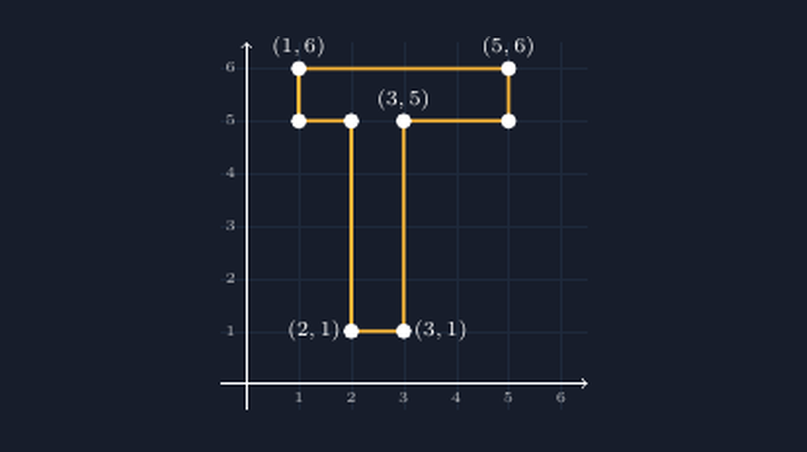

Ada satu topik yang setiap tahun membuat saya penasaran: sistem koordinat Kartesius. Secara teknis, materi ini terhitung ringan. Sumbu $x$, sumbu $y$, titik potong di $(0,0)$, lalu pasangan bilangan $(x, y)$. Kalau ditanya lewat soal pilihan ganda, hampir semua siswa kelas VII bisa menjawab benar. Tapi kalau saya perhatikan cara mereka bekerja — bukan hanya jawabannya — ada sesuatu yang terasa kosong. Koordinat bagi sebagian siswa masih hafalan tata letak: "x dulu, baru y", "kanan positif, kiri negatif", dan seterusnya. Mereka tahu aturannya, tapi tidak pernah merasakan koordinat sebagai *alat* untuk sesuatu yang mereka sendiri ingin buat.

Tahun ini saya mencoba sesuatu yang sangat sederhana, dan justru sederhana itulah yang membuatnya berhasil.

<!--more-->

## Ide yang Muncul dari Papan Paku

Di kelas kami ada papan paku bekas proyek kelas lain, jutaan kali saya ceritakan di tulisan-tulisan sebelumnya. Suatu pagi sebelum jam pelajaran, saya iseng mengaitkan benang dari paku ke paku di papan itu dan membentuk huruf. Ketika siswa mulai berdatangan, ada yang bertanya, "Pak, itu huruf apa?" Saya jawab dengan kalimat yang tidak saya rencanakan: "Huruf yang titik-titiknya saya titipkan di papan. Kalau kalian tahu alamat setiap paku, kalian bisa menulis nama sendiri."

Kalimat itu jadi benih aktivitas. Minggu itu juga saya siapkan lembar kertas berpetak — kertas milimeter blok yang biasa saya gambar sendiri — dengan sumbu koordinat dari 0 sampai 15 untuk kedua arah. Tugasnya: **menulis inisial nama sendiri menggunakan titik-titik koordinat**, lalu menukarkan daftar titik itu dengan teman sebangku. Teman yang menerima daftar titik harus "membaca" dan menemukan huruf apa yang tersembunyi di dalamnya.

## Aturan yang Sengaja Dibuat Ketat

Agar aktivitas tidak berubah menjadi menggambar bebas, saya buat aturan sederhana tapi ketat:

1. Huruf hanya boleh terdiri dari segmen garis lurus yang menghubungkan dua titik koordinat (tidak boleh ada lengkungan).
2. Daftar titik ditulis berurutan sebagai pasangan $(x, y)$, satu baris satu titik, dan garis terakhir kembali ke titik pertama.
3. Teman yang membaca tidak boleh bertanya. Kalau hurufnya tidak terbaca, berarti daftar titiknya yang bermasalah.

Aturan ketiga adalah yang paling saya senangi. Ia secara diam-diam memindahkan tanggung jawab kejelasan dari pembaca ke penulis. Selama ini di kelas, sering kali siswa menggambar sesuatu yang hanya dia sendiri paham, lalu heran kenapa orang lain salah membaca. Di sini, jika hasil temannya bukan huruf R atau huruf S yang dimaksud, ia tidak bisa menyalahkan temannya — ia harus memeriksa kembali apakah urutan titiknya benar-benar menjelaskan bentuk huruf itu.

## Huruf T sebagai Contoh Bersama

Sebelum siswa bekerja dengan inisial masing-masing, kami menyelesaikan satu contoh bersama: huruf T. Saya gambar di papan dengan kertas berpetak, dan kami tetapkan delapan titik:

$$(1,6) \to (5,6) \to (5,5) \to (3,5) \to (3,1) \to (2,1) \to (2,5) \to (1,5) \to (1,6)$$


*Huruf T dari delapan titik koordinat. Perhatikan bahwa bagian vertikal lebar satu satuan — dari $x = 2$ sampai $x = 3$ — supaya hurufnya punya "batang" yang tidak tipis.*

Contoh ini terlihat sepele, tapi justru di sini miskonsepsi klasik muncul dengan sendirinya. Ada siswa yang menuliskan titik pertama sebagai $(6, 1)$ — membalik urutan $x$ dan $y$ — dan heran kenapa hurufnya "miring". Ada juga yang menyamakan $(3,5)$ dengan $(5,3)$ dan tidak sadar keduanya menunjuk titik yang berbeda. Karena kesalahannya langsung terlihat pada bentuk huruf — bukan dicoret merah oleh saya — siswa yang salah itu sendiri yang menemukan dan membetulkannya. Tidak ada nilai yang hilang, tidak ada rasa malu. Ada cuma satu huruf T yang keliru, lalu diperbaiki dalam hitungan detik.

## Apa yang Berubah di Kelas

Saya tidak akan berlebihan mengatakan aktivitas ini mengubah segalanya. Tapi ada dua perubahan yang saya rasakan cukup nyata.

Pertama, istilah "sumbu" dan "titik" berhenti menjadi kosmologi abstrak. Ketika siswa ingin bagian batang hurufnya lurus di $x = 3$, ia harus benar-benar paham bahwa *semua* titik dengan $x = 3$ membentuk garis vertikal — bukan karena saya mengatakan itu di depan kelas, tapi karena hurufnya rusak kalau salah. Konsep garis vertikal $x = a$ dan garis horizontal $y = b$, yang biasanya saya jelaskan dengan lambat di pertengahan bab, muncul duluan dari kebutuhan siswa sendiri.

Kedua, urutan penulisan $(x, y)$ tidak lagi murni hafalan. Siswa yang terbiasa membalik urutan akan segera menemukannya sendiri, karena balik urutan membalik bentuk hurufnya. Umpan baliknya instan, visual, dan milik siswa.

Ada satu momen kecil yang saya simpan. Seorang siswa yang biasanya paling cepat menyerah pada soal matematika — sebut saja dia B — datang ke meja saya dengan daftar titik untuk tiga huruf, inisial namanya. Ia berkata, "Pak, huruf O kok susah ya, pakai garis lurus?" Kami lalu bicara sebentar tentang kenapa huruf berbahasa Indonesia yang melingkar sulit dibuat dari segmen garis, dan dia sendiri yang mengusulkan mengganti lengkungnya dengan poligon. Untuk ukuran dia, itu percakapan matematika paling panjang yang pernah kami lakukan.

## Dari Kertas ke TikZ

Seperti kebiasaan saya belakangan ini, setelah aktivitas kelas selesai saya coba bawa ke ranah digital: menggambar ulang huruf T tersebut dengan TikZ, supaya bisa saya pakai di lembar kerja tahun depan tanpa menggambar ulang dari nol. Kodenya ternyata pendek, karena inti dari aktivitas ini memang cuma daftar koordinat:

```latex
\draw[aksen, very thick]
  (1,6) -- (5,6) -- (5,5) -- (3,5) -- (3,1)
  -- (2,1) -- (2,5) -- (1,5) -- cycle;
\foreach \p in {(1,6),(5,6),(5,5),(3,5),(3,1),(2,1),(2,5),(1,5)}
  \fill[putih] \p circle (2.6pt);
```

Hal yang saya suka dari TikZ untuk aktivitas macam ini: daftar titik di kode persis sama dengan daftar titik di lembar siswa. Tidak ada jarak antara yang saya gambar dan yang mereka kerjakan. Kalau tahun depan saya ingin mengganti huruf T menjadi inisial sekolah, saya tinggal mengganti daftar titiknya — dan memeriksa sekali lagi apakah bentuknya masih terbaca.

## Penutup: Alamat yang Berguna

Kalau saya renungkan, inti dari aktivitas ini bukanlah sistem koordinat itu sendiri, melainkan alasan mengapa koordinat layak dipelajari: ia adalah cara memberi *alamat* pada posisi, dan alamat hanya berguna kalau ada sesuatu yang ingin kita temukan atau kirimkan ke sana. Selama satu-satunya "sesuatu" itu adalah titik A dan titik B di soal buku paket, koordinat akan tetap terasa seperti tata bahasa tanpa kalimat.

Begitu siswa menitipkan inisial namanya pada daftar titik — begitu ada sesuatu yang personal yang dikirim lewat koordinat — aturan-aturan yang tadinya hafalan berubah menjadi kontrak yang harus dipatuhi supaya pesan sampai. Saya mulai percaya bahwa banyak topik matematika SMP sebenarnya menunggu hal yang sama: bukan penjelasan yang lebih bagus, tapi sebuah *keperluan* yang cukup kecil untuk langsung dikerjakan dan cukup nyata untuk diperhatikan.

Kalau Bapak/Ibu ingin mencoba, persiapannya sangat ringan: kertas berpetak, satu contoh bersama, satu aturan bahwa pembaca tidak boleh bertanya. Sisanya biarkan nama-nama mereka yang bicara.

> 📎 **Berkas TikZ lengkap:** [tikz-titik-koordinat-huruf.tex](tex/tikz-titik-koordinat-huruf.tex) — siap kompilasi (butuh paket `tikz`).
