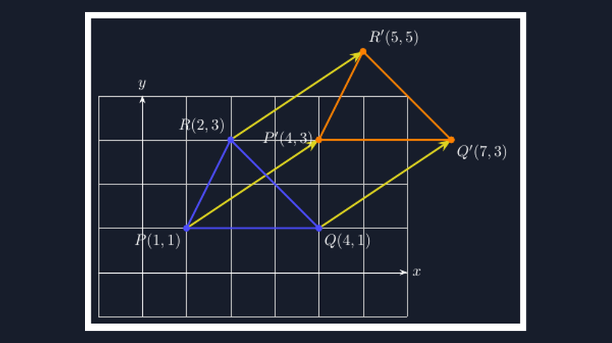

Transformasi geometri itu salah satu materi yang paling sering saya gambarkan miring. Bukan miring secara harfiah — meskipun kadang iya — tapi secara makna. Ada tahun ketika saya menggambar pergeseran di papan tulis dengan tangan: titik $A$, lalu panah ke kanan, lalu titik $A'$ yang "kira-kira" tiga kotak dari titik asalnya. Kira-kira. Dan persis kata itulah masalahnya. Siswa yang menatap gambar itu tidak sedang melihat konsep pergeseran; mereka melihat titik yang pindah *kira-kira ke sana*.

<!--more-->

## Masalahnya Bukan di Siswa, Tapi di Gambarnya

Pergeseran (translasi) pada dasarnya adalah materi yang sederhana: setiap titik pada bangun berpindah sejauh dan searah yang sama, mengikuti sebuah vektor. Kalau vektornya $\binom{3}{2}$, maka titik $(1,1)$ pindah ke $(4,3)$ — tidak ada negosiasi, tidak ada "kira-kira".

Tapi perhatikan apa yang terjadi di kelas ketika gambar papan tulisnya kurang presisi. Siswa menghitung dengan benar, misalnya menjawab bahwa titik $A(2,1)$ bergeser tiga ke kanan dan dua ke atas. Lalu mereka membandingkan jawaban itu dengan gambar saya di papan — dan titik $A'$ saya tampak hanya bergeser dua kotak setengah, karena jarak antar garis kisi yang saya gambar tidak benar-benar sama panjang. Anak yang teliti jadi ragu pada hitungannya sendiri. Siswa yang tidak teliti belajar pelajaran yang salah: bahwa matematika itu memang kira-kira.

Saya pernah menangkap buku catatan seorang siswa yang menyalin gambar pergeseran saya, lalu di pojok halusinya dia menulis kecil: *"bu kok gambarnya beda sama punya temen ya padahal soalnya sama."* Dua gambar, dua sumber kebingungan. Sejak itu saya jadi curiga: mungkin banyak kesulitan siswa pada materi transformasi bukan berasal dari konsepnya, tapi dari gambar-gambar yang menyertainya — gambar yang tidak menjamin hubungan antara angka di soal dan jarak di kertas.

## Kenapa Saya Pindah ke TikZ

TikZ tidak menggambar panah secara feeling. Ia menggambar dari koordinat, dan koordinat itu berasal dari hitungan yang sama dengan hitungan yang kita ajarkan. Inilah alasan filosofis kenapa saya memilihnya untuk materi transformasi: gambar TikZ *dibangun dari konsep yang sama* dengan materi yang digambarkan. Vektor pergeseran di soal dan vektor pergeseran di gambar adalah objek yang identik — sama-sama pasangan bilangan, sama-sama dihitung, bukan digambar pakai mata.

Potongan inti untuk menggambar satu titik yang bergeser sepanjang $\binom{3}{2}$ kira-kira begini:

```latex
\begin{tikzpicture}[scale=1]
  \draw[help lines, color=gray!30] (-1,-1) grid (6,4);
  \draw[->] (-1,0) -- (6,0) node[right] {$x$};
  \draw[->] (0,-1) -- (0,4) node[above] {$y$};
  \coordinate (A) at (2,1);
  \coordinate (Ap) at ($(A)+(3,2)$);
  \draw[very thick, -Stealth] (A) -- (Ap);
  \filldraw (A) circle (2pt) node[below left] {$A(2,1)$};
  \filldraw (Ap) circle (2pt) node[above right] {$A'(5,3)$};
\end{tikzpicture}
```

Perhatikan baris `\coordinate (Ap) at ($(A)+(3,2)$);`. Ini yang saya suka. Titik bayangan tidak saya taruh dengan tangan di posisi yang saya rasa pas — ia *dihitung* dari titik asalnya ditambah vektor pergeseran. Kalau saya mengubah soalnya jadi $\binom{-2}{4}$, saya cukup mengganti dua angka itu, dan seluruh gambar ikut menyesuaikan dengan jaminan bahwa panahnya sekarang benar-benar sepanjang dua kotak ke kiri dan empat kotak ke atas.

## Tiga Bangun, Satu Vektor, Satu Kebenaran

Bagian yang paling sering bikin siswa bingung adalah pergeseran *bangun*, bukan hanya titik. Di papan tulis, menggeser segitiga secara manual berarti menggambar tiga titik bayangan yang masing-masing "kira-kira" pas — dan satu titik saja yang meleset sedikit, segitiganya berubah bentuk, padahal secara konsep pergeseran harus mempertahankan bentuk dan ukuran.

Dengan TikZ, ini justru jadi kekuatannya:

```latex
\coordinate (P) at (1,1);
\coordinate (Q) at (4,1);
\coordinate (R) at (2,3);
\foreach \p in {P,Q,R} {
  \coordinate (\p') at ($(\p)+(3,2)$);
}
\draw[blue, thick] (P) -- (Q) -- (R) -- cycle;
\draw[orange, thick] (P') -- (Q') -- (R') -- cycle;
```

Perulangan `\foreach` menggeser ketiga titik dengan vektor yang sama, satu perintah untuk semua. Segitiga bayangan tidak mungkin "meleset sedikit" karena ia tidak digambar — ia dihitung. Bentuk dan ukurannya terjaga secara otomatis, persis seperti yang kita klaim di kelas: pergeseran mempertahankan bentuk, ukuran, dan orientasi.



Gambar di atas saya buat dengan pola yang sama seperti kode TikZ-nya: kisi kisi yang jelas, vektor pergeseran yang digambar dari *setiap* titik sudut (bukan cuma dari satu titik), dan segitiga bayangan yang posisinya dijamin oleh aritmetika, bukan oleh tangan. Ketika siswa melihat tiga panah yang sama panjang dan sama arah dari ketiga titik sudut, konsep "setiap titik berpindah sama jauh" tidak lagi jadi kalimat hafalan — ia jadi penglihatan.

## Yang Tidak Bisa Digambar Papan Tulis: Kombinasi Transformasi

Materi transformasi di SMP biasanya berhenti di satu transformasi per soal. Tapi begitu siswa bertemu soal gabungan — geser dulu, lalu cermin terhadap sumbu $x$ — papan tulis mulai kewalahan. Gambar jadi ramai, garis bantu tercampur, dan siswa tidak bisa membedakan mana jejak transformasi pertama dan mana yang kedua.

Di TikZ, tiap tahap transformasi bisa diberi warna dan gaya garis berbeda, dan yang penting: *konsisten antar gambar*. Saya bisa menyeragamkan konvensi — biru untuk bangun asal, jingga untuk hasil transformasi pertama, putus-putus untuk hasil transformasi kedua — lalu memakainya di seluruh rangkaian soal latihan. Siswa yang mengerjakan dua puluh soal berurutan tidak perlu menebak ulang kode warna di tiap soal. Konsistensi visual ini mungkin terdengar sepele, tapi dia yang membuat soal latihan terasa seperti satu rangkaian pembelajaran, bukan kumpulan gambar lepas.

Ada satu hal lagi yang saya hargai: soal bisa saya buat *tanpa jawabannya terlihat benar-benar mudah ditebak dari gambar*. Karena TikZ menaruh titik dari koordinat, saya bisa membuat variasi soal dengan vektor yang berbeda-beda tanpa risiko dua soal kebetulan terlihat sama. Coba lakukan itu dengan tangan di papan untuk empat puluh soal latihan.

## Refleksi dari Sudut Pengajar, Bukan Programmer

Saya bukan orang yang gemar memuji teknologi untuk teknologi. Banyak alat yang saya coba dan akhirnya saya tinggalkan karena hanya menambah kerumitan tanpa menambah pemahaman siswa. TikZ untuk transformasi berbeda — bukan karena otomatisnya, tapi karena kejujurannya. Gambar tidak bisa berbohong soal jarak, karena gambar itu sendiri lahir dari koordinat yang dihitung.

Pelajaran terbesar saya selama bermigrasi ke TikZ justru tentang diri saya sebagai pengajar: selama bertahun-tahun saya mengira siswa saya kesulitan memahami transformasi. Ternyata yang terjadi lebih sederhana dan lebih menyakitkan — mereka kesulitan mempercayai gambar yang saya tampilkan. Dan kepercayaan, di kelas matematika seperti di tempat lain, adalah prasyarat semua pemahaman.

Kalau Bapak/Ibu guru matematika belum pernah mencoba TikZ untuk materi transformasi, saya sarankan mulai dari pergeseran. Paling sederhana dari semua transformasi, tapi paling cepat menunjukkan perbedaannya: sekali vektor di soal dan panah di gambar berjarak sama persis, siswa berhenti mengira matematika itu kira-kira — dan mulai mengira bahwa angka, kalau dihitung dengan benar, selalu menepati janjinya.

> 📎 **Berkas TikZ lengkap:** [tikz-transformasi-geometri-pergeseran.tex](tex/tikz-transformasi-geometri-pergeseran.tex) — siap kompilasi (butuh paket `tikz`).
