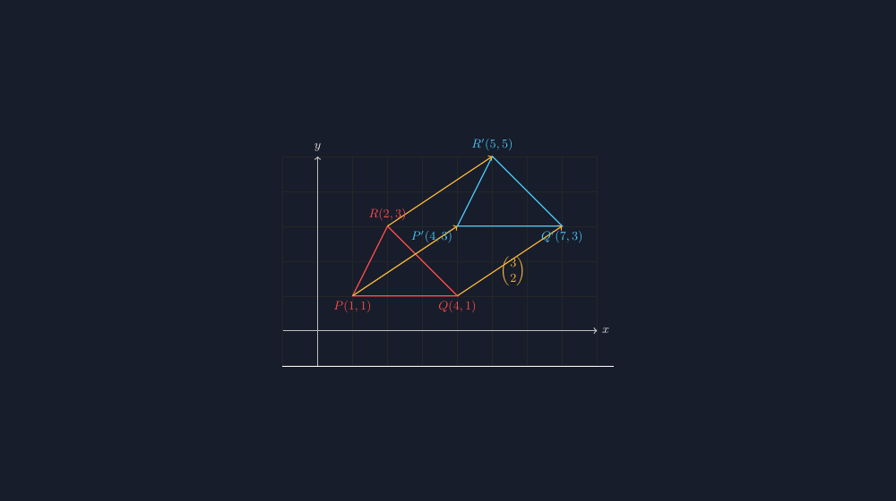

Anak-anak kelas VIII saya biasanya tidak kesulitan dengan definisi translasi. "Setiap titik bergeser searah dan sejauh sama," begitu bunyinya di buku. Tapi ketika saya minta mereka menggambar bayangan titik $A(1, 2)$ oleh translasi $\begin{pmatrix} 3 \\ -1 \end{pmatrix}$, di papan tulis muncul segala macam arah panah. Ada yang menggeser tiga satuan ke kanan lalu satu ke atas. Ada yang menukar ordina dan absis. Ada satu anak, Dava, yang menggambar bayangannya persis di titik asal — "soalnya angkanya minus, Bu, jadi hilang," katanya dengan wajah paling yakin di kelas.

<!--more-->

Dari situ saya sadar bahwa masalahnya bukan definisi, tapi gambar. Translasi adalah transformasi yang paling "bisa dibayangkan" — geser saja — tapi juga paling gampang digambar asal-asalan, karena tidak ada sudut yang harus diukur, tidak ada cermin, tidak ada faktor skala. Cuma panah. Dan panah yang digambar tangan memang sering menipu: satu panah kelihatan lebih panjang dari yang lain padahal seharusnya sama, bayangan bentuknya sedikit melebar karena penggaris bergeser setengah milimeter.

Makanya untuk materi translasi ini saya kembali ke TikZ. Kalau gambar soal ujian dan contoh kelas saya bikin dengan koordinat yang persis, panahnya pasti sama panjang, bayangannya pasti kongruen, dan saya tidak perlu lagi menjawab pertanyaan "Bu, kok gambarnya di buku beda dengan di papan?"



*Tiga panah translasi $\begin{pmatrix}3\\2\end{pmatrix}$ yang sama arah dan sama panjang — dari setiap titik sudut segitiga asal (merah) ke titik sudut bayangannya (biru).*

## Translasi itu geser, titik demi titik

Ide dasarnya sederhana. Setiap titik $(x, y)$ dipindahkan sebesar $a$ satuan horizontal dan $b$ satuan vertikal, sehingga bayangannya di $(x+a, y+b)$. Notasinya bisa ditulis sebagai matriks kolom:

$$T = \begin{pmatrix} a \\ b \end{pmatrix}, \qquad A(x, y) \xrightarrow{T} A'(x+a, y+b)$$

Kunci yang ingin saya tanamkan ke siswa: *semua* titik berpindah dengan panah yang sama. Kalau segitiga ditranslasikan, ketiga sisinya tidak berubah panjang, ketiga sudutnya tidak berubah besar — bentuknya cuma pindah alamat. Ini beda dengan dilatasi yang mengubah ukuran, atau rotasi yang memutar arah.

Di TikZ, translasi justru jadi hal yang paling mudah karena koordinatnya bisa dihitung langsung. Berikut potongan kode yang saya pakai untuk menggambar titik $A$ dan bayangannya:

```latex
\begin{tikzpicture}[scale=0.8]
  % grid bantu
  \draw[gray!30, very thin] (-1,-2) grid (7,4);
  \draw[->] (-1,0) -- (7,0) node[right] {$x$};
  \draw[->] (0,-2) -- (0,4) node[above] {$y$};

  % titik asal dan bayangan
  \coordinate (A) at (1,2);
  \coordinate (Ap) at (4,1);   % A + (3,-1)

  \fill[red]  (A)  circle (2.5pt) node[above left] {$A(1,2)$};
  \fill[blue] (Ap) circle (2.5pt) node[above left] {$A'(4,1)$};

  % panah translasi — dari A ke A'
  \draw[->, thick, orange!80!black] (A) -- (Ap)
        node[midway, below right] {$\begin{pmatrix}3\\-1\end{pmatrix}$};
\end{tikzpicture}
```

Yang saya suka dari kode ini: koordinat $A'$ tidak saya tulis asal, tapi memang dihitung $1+3=4$ dan $2+(-1)=1$. Kalau saya ganti vektor translasinya, bayangan otomatis ikut berpindah ke tempat yang benar. Gambar tidak bisa bohong.

## Translasi segitiga: satu panah, diulang di tiga titik

Untuk bangun datar, saya selalu menggambar panah translasi di *setiap* titik sudut, bukan cuma satu. Ini penting untuk menanamkan inti translasi — kekongruenan arah dan jarak. Kalau cuma satu panah, siswa sering mengira yang dipindah hanya titik itu, dan sisanya "mengikuti entah bagaimana".

```latex
\begin{tikzpicture}[scale=0.8]
  \draw[gray!30, very thin] (-1,-1) grid (8,5);
  \draw[->] (-1,0) -- (8,0) node[right] {$x$};
  \draw[->] (0,-1) -- (0,5) node[above] {$y$};

  % segitiga asal
  \coordinate (P) at (1,1);
  \coordinate (Q) at (4,1);
  \coordinate (R) at (2,3);
  \draw[thick, red] (P) -- (Q) -- (R) -- cycle;

  % bayangan: semua titik ditambah (3,2)
  \coordinate (P') at (4,3);
  \coordinate (Q') at (7,3);
  \coordinate (R') at (5,5);
  \draw[thick, blue] (P') -- (Q') -- (R') -- cycle;

  % panah dari tiap titik ke bayangannya
  \foreach \p/\q in {P/P', Q/Q', R/R'} {
    \draw[->, orange!80!black] (\p) -- (\q);
  }

  \foreach \pt/\l/\a in {P/{$P(1,1)$}/below, Q/{$Q(4,1)$}/below,
                         R/{$R(2,3)$}/above} {
    \node[\a, red] at (\pt) {\l};
  }
  \node[below, blue] at (P') {$P'(4,3)$};
  \node[below, blue] at (Q') {$Q'(7,3)$};
  \node[above, blue] at (R') {$R'(5,5)$};

  % label vektor di salah satu panah
  \node[orange!80!black, below] at (2.5,2.2) {$\begin{pmatrix}3\\2\end{pmatrix}$};
\end{tikzpicture}
```

Di kelas, gambar seperti ini saya jadikan bahan tanya-jawab sebelum latihan. "Coba ukur panahnya, sama semua nggak?" Siswa menghitung kotak grid dan menemukan sendiri bahwa setiap panah meliputi tiga kotak ke kanan dan dua kotak ke atas. Penemuan sendiri itu jauh lebih melekat daripada definisi yang saya diktakan.

> 📎 **Berkas TikZ lengkap:** [tikz-translasi.tex](tex/tikz-translasi.tex) — siap kompilasi (butuh paket `tikz` dan `amsmath`).

## Jebakan tanda yang muncul lagi

Pengalaman dengan Dava tadi ternyata bukan kasus tunggal. Vektor translasi dengan komponen negatif adalah tempat miskonsepsi lama bernapas kembali — miskonsepsi yang sama dengan bilangan bulat di garis bilangan yang pernah saya tulis dulu. Minus di depan angka dianggap "menghapus", bukan "membalik arah".

Strategi saya sekarang: sebelum menyentuh notasi matriks, kita bermain dulu dengan perintah lisan. "Geser dua kanan, tiga bawah." Semua siswa bisa. Baru setelah itu saya tanya, "Kalau saya tulis $\begin{pmatrix}2\\-3\end{pmatrix}$, artinya apa?" Dan mereka menjawab dengan benar, karena minus sudah punya makna gerakan di tubuh mereka — bukan sekadar tanda yang mengubah angka jadi aneh.

TikZ membantu di sini juga. Saya bikin slide dengan dua gambar berdampingan: satu dengan translasi $(2, 3)$ dan satu dengan $(2, -3)$, sama persis kodenya kecuali satu tanda. Perbedaannya terlihat instan — bayangan yang tadinya naik, sekarang turun, dan *bentuknya tidak berubah sama sekali*. Satu karakter minus, satu arah dunia yang berbeda.

## Bayangan yang sama persis, di alamat baru

Apa yang saya paling hargai dari menggambar translasi dengan TikZ? Konsistensinya. Ketika siswa membandingkan segitiga asal dan bayangannya di gambar soal, mereka bisa menghitung sendiri dan menemukan bahwa sisi-sisi yang bersesuaian memang sama panjang — persis seperti janji definisi. Gambar tidak melabr, tidak menyelipkan kesalahan gambar tangan yang malah memicu miskonsepsi baru ("kok bayangannya lebih gemuk?").

Dan ada satu keuntungan kecil yang tidak terduga: karena kode TikZ translasi cuma beda satu angka dengan kode dilatasi atau refleksi yang pernah saya buat, siswa yang saya ajak melihat kodenya ikut menangkap pola — bahwa transformasi-transformasi itu keluarga yang sama, tinggal ganti aturan perpindahannya. Dari papan tulis ke kode, dari kode kembali ke pemahaman. Itu jalan yang bagi saya dan anak-anak kelas VIII di Punggur, terasa jujur.

Terakhir, nasihat kecil dari guru ke guru: jangan menulis sendiri koordinat bayangan di gambar — biarkan siswa yang menemukannya, pakai gambar yang koordinatnya bisa dipercaya. TikZ memang alat teknis, tapi yang diajari siswa bukan TikZ-nya; yang diajari adalah keyakinan bahwa matematika itu konsisten, dan gambar yang baik adalah buktinya.
