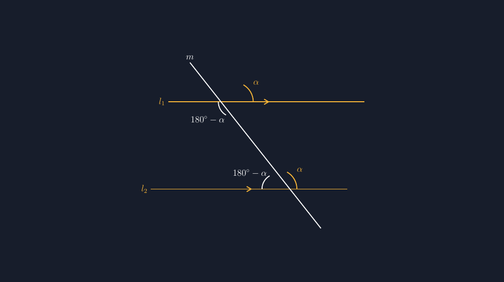

Ada materi yang kalau diajarkan lewat ceramah, siswa bisa hafal tiga istilahnya tapi tetap salah ketika menghadapi gambar soal. Pasangan sudut yang lahir dari dua garis sejajar yang dipotong satu garis transversal adalah contohnya. *Sehadap*, *bersudut berhadapan* (alternate), dan *sepihak* — tiga istilah itu mudah diucapkan. Tapi ketika saya memberi soal sederhana: "Sebutkan pasangan sudut sehadapnya," setengah kelas menunjuk sudut yang salah. Bukan karena mereka tidak paham konsepnya, tapi karena gambar di soalnya tidak membantu.

<!--more-->

Malam itu saya merenungi lembar soal yang biasa saya pakai. Gambar dua garis sejajarnya saya buat asal: satu garis miring menyilang dua garis datar, sudut-sudutnya tidak diberi tanda, dan yang paling fatal — kedua garis yang saya klaim sejajar ternyata tidak benar-benar sejajar kalau diukur. Beda satu-dua derajat. Mata saya mungkin tidak menyadarinya, tapi mata siswa bisa, dan anehnya itu justru membuat mereka ragu: kalau gambarnya saja tidak jujur, harusnya saya percaya gambar atau percaya kalimat "diketahui $l_1 \parallel l_2$"?

Jawabannya tentu kalimatnya. Tapi pengalaman mengajar mengajarkan saya bahwa siswa kelas VII itu masih sangat visual. Mereka belum sepenuhnya percaya pada kalimat "diketahui" — mereka percaya pada yang mereka lihat. Maka gambar yang tidak presisi itu bukan sekadar kurang rapi; ia diam-diam merusak kepercayaan siswa pada seluruh soal.

## Hanya Dua Titik Potong, Tapi Delapan Sudut

Dari satu persilangan dua garis, kita sudah kenal empat sudut yang jumlahnya $360^{\circ}$. Ketika garis transversal menyilang *dua* garis sejajar, jumlahnya menjadi delapan sudut. Di situlah kekayaannya: enam pasangan hubungan antarsudut yang punya nama masing-masing.

Misalkan sudut lancip yang terbentuk di persilangan atas adalah $\alpha$. Maka di persilangan bawah, karena kedua garis sejajar, sudut yang "seposisi" dengannya juga besarnya $\alpha$. Dari sini seluruh pasangan lahir secara alami:

- **Sehadap** (corresponding): sudut yang menempati posisi yang sama di kedua titik potong. Besarnya sama, $\alpha$.
- **Bersudut berhadapan** (alternate): sudut yang berada di sisi berlawanan transversal, "berhadapan melintasi" garis transversal. Besarnya juga sama dengan $\alpha$.
- **Dalam sepihak** (co-interior): dua sudut yang sama-sama berada di antara kedua garis sejajar, di sisi yang sama dari transversal. Keduanya berjumlah $180^{\circ}$ — saling berpelurus secara tak langsung.

Yang membuat saya gemas pada soal-soal lama: tiga istilah itu sering diajarkan sebagai tiga hafalan terpisah. Padahal kalau gambar digambar dengan satu sudut $\alpha$ yang diberi tanda jelas, ketiganya bisa *dibaca langsung* dari gambar. Siswa tidak perlu menghafal — mereka tinggal melacak posisi.

## Menuntut Gambar yang Jujur

Di sinilah TikZ masuk. Saya ingin gambar di lembar soal memenuhi dua syarat: kedua garis benar-benar sejajar (bukan "kira-kira sejajar"), dan sudut-sudut yang dibicarakan diberi tanda busur dengan label yang konsisten. Ini kode inti yang saya pakai:

```latex
\coordinate (P) at (3,0);
\coordinate (Q) at (5,-4);
\draw (0,0) node[left]{$l_1$} -- (9,0);
\draw (-0.8,-4) node[left]{$l_2$} -- (8.2,-4);
\draw (1.0,1.8) node[above]{$m$} -- (7.0,-5.8);
% sudut sehadap: busur sama di P dan Q, posisi sama
\draw ($(P)+(0.9,0)$) arc[start angle=0, end angle=60, radius=0.9];
\node at ($(P)+(40:1.35)$) {$\alpha$};
\draw ($(Q)+(0.9,0)$) arc[start angle=0, end angle=60, radius=0.9];
\node at ($(Q)+(40:1.35)$) {$\alpha$};
```

Kuncinya ada di koordinat. $l_1$ digambar dari $(0,0)$ ke $(9,0)$ — sepenuhnya datar, jadi sejajarnya dijamin. $l_2$ juga datar, hanya digeser empat satuan ke bawah. Tidak ada kemungkinan "kira-kira sejajar" karena secara matematis keduanya adalah garis $y = 0$ dan $y = -4$. Transversalnya saya buat miring agar siswa tidak terkecoh dengan gambar yang terlalu tegak lurus — justru kemiringan itulah yang membuat latihan membaca posisi sudut jadi bermakna.

Busur sudut sehadap di kedua titik potong sengaja saya beri *radius dan rentang sudut yang sama persis* ($0^{\circ}$ sampai $60^{\circ}$, radius $0{,}9$). Ini detail kecil tapi penting: kesamaan bentuk busur memberi isyarat visual bahwa kedua sudut itu senilai, sebelum siswa bahkan membaca kalimat "diketahui sejajar".


*Gambar hasil kompilasi: dua garis sejajar $l_1$ dan $l_2$ dipotong transversal $m$. Sudut sehadap diberi tanda sama ($\alpha$), sedangkan sudut dalam sepihak dan yang berhadapan otomatis bernilai $180^{\circ}-\alpha$.*

Hasil kompilasinya bisa Anda lihat di atas. Yang saya suka dari gambar seperti ini: dia bisa dipakai untuk bertanya berlapis. Pertanyaan pertama, "Mana pasangan sudut sehadapnya?" Pertanyaan kedua, "Kalau $\alpha = 55^{\circ}$, berapa ketiga sudut lainnya?" Pertanyaan ketiga — dan ini favorit saya — "Sudut mana yang pasti sama tanpa perlu tahu garisnya sejajar?" Pertanyaan terakhir ini membawa siswa pada sudut berpelurus yang terbentuk di satu titik potong saja, konsep yang tidak butuh kesejajaran sama sekali. Gambarnya yang konsisten memungkinkan pertanyaan bertingkat seperti itu tanpa perlu menggambar ulang.

## Apa yang Berubah di Kelas

Tahun lalu, materi ini saya ajarkan dengan gambar hasil coretan papan tulis. Tahun ini saya bawa gambar hasil TikZ yang sama untuk semua soal latihan — gambar yang konsisten dari soal nomor satu sampai terakhir, dengan konvensi tanda busur yang tidak berubah-ubah. Bedanya terasa pada satu hal: pertanyaan siswa berubah. Dulu yang sering muncul "Bu, yang mana sehadapnya?" — pertanyaan yang menandakan mereka belum bisa *membaca* gambar. Sekarang yang lebih sering muncul justru "Kalau transversalnya digeser miring ke arah lain, apakah $\alpha$-nya berubah?" — pertanyaan yang menandakan mereka sudah berpikir tentang hubungan, bukan posisi.

Pertanyaan semacam itu tidak bisa saya beli dengan lembar soal yang gambarnya asal. Dia lahir dari gambar yang cukup jujur sehingga siswa berani bermain dengannya.

Untuk rekan guru yang ingin mencoba: berkas lengkapnya sudah siap kompilasi di bawah. Tidak perlu paket tambahan selain `tikz` (dengan pustaka `calc`) dan `amsmath`. Kalau ingin mengubah kemiringan transversal, cukup geser koordinat titik ujung garis $m$ — busur dan labelnya mengikuti karena semua posisinya saya tulis relatif terhadap titik potong, bukan angka mati.

> 📎 **Berkas TikZ lengkap:** [tikz-transversal-garis-sejajar.tex](tex/tikz-transversal-garis-sejajar.tex) — siap kompilasi (butuh paket `tikz`).

Dari satu persilangan sederhana ternyata bisa lahir begitu banyak pembicaraan matematika. Persoalannya cuma satu: gambarnya harus jujur lebih dulu, supaya siswa percaya untuk mulai bertanya.
