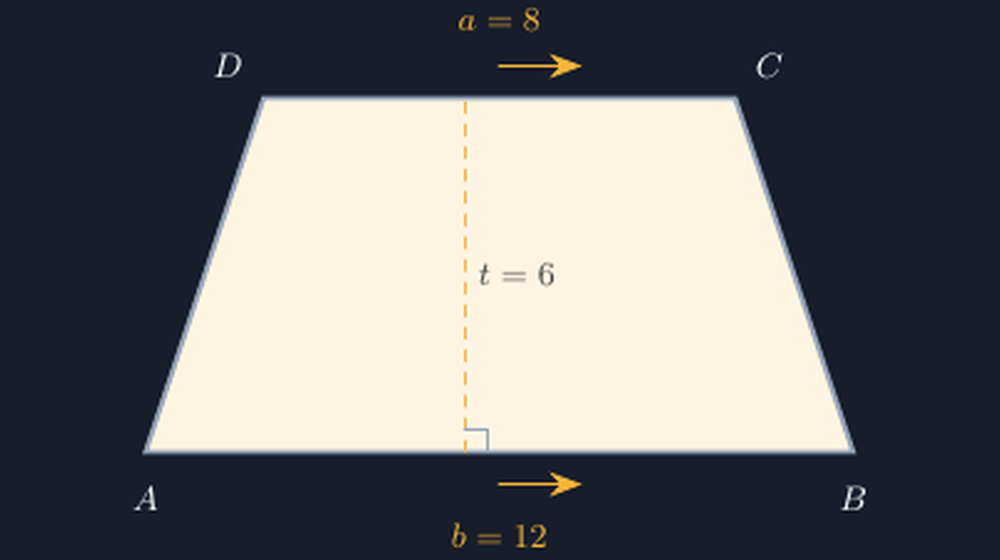
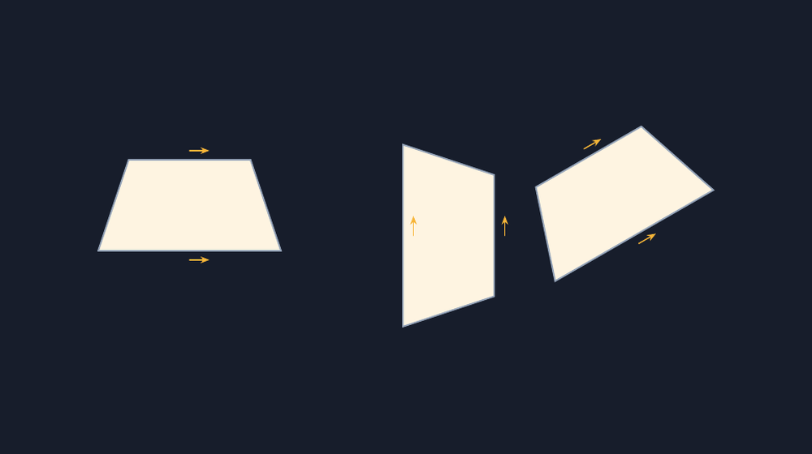

Kemarin saya membagikan lembar soal bangun datar untuk kelas VII. Salah satu soalnya sederhana: hitung luas trapesium pada gambar. Trapesiumnya saya gambar sendiri, cepat-cepat, langsung di pengolah kata. Panjang sisi sejajarnya 12 cm dan 8 cm, tingginya 6 cm. Rapi, menurut saya.

Belum lima menit lembaran beredar, seorang siswa — selanjutnya saya sebut Bagas — mengangkat tangan. "Pak, ini kok sisinya miring dua-duanya ya? Mana yang sejajar?"

Saya mendekat dan melihat gambar itu. Benar. Trapesium yang saya buat asal-asalan itu punya sisi atas yang miring sedikit ke kiri, dan sisi bawah yang miring sedikit juga — ke arah yang sama. Tidak ada sepasang sisi di gambar itu yang benar-benar sejajar. Secara rumus, luasnya tetap bisa dihitung karena angkanya sudah ditulis. Tapi secara penglihatan, gambar itu berbohong tentang sifat bangunnya sendiri.

<!--more-->

## Kesalahan yang Sering Saya Lakukan Sendiri

Jujur saja, itu bukan pertama kalinya. Kalau tidak sedang hati-hati, trapesium yang saya gambar di papan tulis hampir selalu "hampir benar": dua sisi tampak sejajar, tapi kalau diukur dengan penggaris, kemiringannya beda beberapa derajat. Di papan tulis, anak-anak jarang protes. Mungkin karena mereka menganggap gambar guru pasti benar — dan justru itu yang membuat saya semakin tidak nyaman.

Masalahnya, trapesium itu bangun yang seluruh identitasnya bergantung pada satu properti: ada sepasang sisi yang sejajar. Sisi sejajar itulah yang jadi alas rumus luasnya:

$$L = \frac{(a + b)}{2} \cdot t$$

dengan $a$ dan $b$ panjang dua sisi sejajar dan $t$ tingginya. Kalau gambar tidak menunjukkan kesejajaran itu, rumusnya terasa datang dari mana-mana. Anak menghafal "jumlah sisi sejajar dikali tinggi dibagi dua" tanpa pernah melihat dengan mata sendiri bahwa kedua sisi itu memang sejajar.

Jadi minggu ini saya memutuskan menggambar ulang trapesium untuk bahan ajar memakai TikZ. Kalau koordinatnya saya tulis dengan angka yang jujur, kesejajarannya dijamin oleh matematika, bukan oleh keberuntungan tangan saya.

## Merancang Koordinat yang Jujur

Rencananya sederhana. Saya mau trapesium dengan sisi bawah sepanjang 12 satuan, sisi atas sepanjang 8 satuan, tinggi 6 satuan. Syaratnya: sisi atas harus **persis** horizontal, sejajar dengan sisi bawah. Di TikZ, kesejajaran itu saya kunci lewat koordinat:

```latex
\coordinate (A) at (0,0);
\coordinate (B) at (12,0);
\coordinate (C) at (10,6);
\coordinate (D) at (2,6);
\draw[thick] (A) -- (B) -- (C) -- (D) -- cycle;
```

Perhatikan bahwa titik $D$ dan $C$ sama-sama berada di garis $y = 6$. Itu artinya sisi $DC$ pasti horizontal — bukan karena gambar saya bagus, tapi karena koordinatnya sama tinggi. Sisi bawah $AB$ berada di $y = 0$, juga horizontal. Dua garis horizontal itu sejajar secara definisi. Beginilah cara TikZ "memaksa" saya jujur: kalau saya salah menulis koordinat, gambar langsung terlihat melenceng, dan saya tahu harus memperbaiki angkanya, bukan menarik garisnya asal.

Simetri atas-bawah juga saya pikirkan. Sisi atasnya saya geser 2 satuan ke kanan dari tepi kiri bawah, supaya kaki kirinya miring ke dalam dan kaki kanannya juga miring ke dalam dengan jumlah geser yang sama (2 satuan dari masing-masing ujung). Trapesiumnya jadi simetris terhadap garis tengah vertikal — trapesium sama kaki. Kalau mau trapesium sembarang, gesernya tinggal dibuat beda, misalnya $D$ di $(1,6)$ dan $C$ di $(9,6)$.

Sisi miringnya bisa dihitung dengan Pythagoras: kaki kirinya punya pergeseran horizontal 2 dan vertikal 6, sehingga panjangnya

$$\sqrt{2^2 + 6^2} = \sqrt{40} \approx 6{,}32 \text{ satuan}$$

Angka ini berguna kalau saya mau memberi label panjang sisi miring di soal — dan berguna juga saat seorang siswa bertanya "Pak, sisi miringnya berapa?" dan saya bisa menjawab dari perhitungan, bukan mengira-ngira.



## Memberi Tanda bahwa Dua Sisi Memang Sejajar

Di buku pelajaran, kesejajaran biasa ditandai dengan panah kecil di tengah sisi. Kedua sisi sejajar diberi tanda panah yang sama. Di TikZ ini bisa dibuat dengan dekorasi `markings` — tapi agar sederhana, saya letakkan panah kecil dengan posisi di tengah sisi, dihitung lewat koordinat tengah:

```latex
\draw[-{Stealth}, orange] ($(A)!0.5!(B)$) ++(0,-0.35) -- ++(1.2,0);
\draw[-{Stealth}, orange] ($(D)!0.5!(C)$) ++(0,0.35) -- ++(1.2,0);
```

Dua panah kecil itu — satu di bawah sisi bawah, satu di atas sisi atas — tampak sepele. Tapi di kelas tadi, justru itulah yang membuat Bagas puas. Ia menunjuk dua panah itu dan berkata, "Oh, jadi ini tandanya sejajar. Kenapa tadi gambar di lembar tidak ada tandanya?" Pertanyaan yang bikin saya tertawa kecil dan agak malu sekaligus.

## Ketika Trapesium Diputar: Kesejajarannya Ikut Berputar

Satu hal lagi yang biasanya bikin siswa bingung: trapesium di soal ujian sering tidak berdiri "alas di bawah" seperti contoh di buku. Kadang diputar 90 derajat, kadang miring. Siswa yang terbiasa dengan satu orientasi akan kebingungan mencari mana sisi sejajarnya.

Ini bisa diperagakan dengan TikZ tanpa menghitung ulang koordinat — pakai opsi `rotate` pada scope:

```latex
\begin{scope}[rotate=-90]
  \draw[thick] (0,0) -- (12,0) -- (10,6) -- (2,6) -- cycle;
\end{scope}
```

Gambar yang sama, hanya berputar. Dan di sini letakkan pelajaran pentingnya: sisi yang tadi horizontal kini vertikal, tapi keduanya **tetap sejajar satu sama lain** — kesejajaran itu sifat antara dua garis, bukan sifat "berada di bawah". Bagas dan teman-temannya mencoba mencari pasangan sisi sejajar di trapesium yang diputar, dan sekarang mereka melihat panah tanda kesejajarannya lebih dulu daripada posisi alasnya.



## TikZ Itu Kurikulum yang Diam-diam

Yang saya sadari setelah beberapa tahun memakai TikZ untuk bahan ajar: alat ini mengubah cara saya memikirkan gambar matematika. Dulu gambar itu "ilustrasi" — asal mirip. Sekarang gambar adalah pernyataan matematis. Koordinat yang saya tulis adalah pernyataan itu sendiri; kalau pernyataannya salah, gambar salah, dan saya tahu persis di mana salahnya.

Untuk trapesium, pelajarannya konkret: sisi sejajar bukan hal yang "sudah pasti ada" pada gambar, tapi sesuatu yang harus dijamin — di kertas dengan penggaris sejajar, di TikZ dengan koordinat yang sama tinggi. Anak-anak yang terbiasa melihat gambar yang jujur akan mengembangkan indra yang sama: mereka akan mulai curiga pada gambar yang tampak sejajar tapi tidak, dan itu curiga yang sehat dalam matematika.

Malam itu saya mengganti gambar trapesium di lembar soal saya dengan hasil TikZ, memberi tanda panah kesejajarannya, dan menyiapkan satu soal bonus: "Gambarlah trapesiummu sendiri, lalu tandai pasangan sisi yang sejajar. Ukur, apakah benar sejajar?" Besok mereka akan menggambar dengan tangan — dan mungkin untuk pertama kalinya benar-benar memeriksa kesejajaran buatan mereka sendiri, bukan cuma memercayai gambar.

> 📎 **Berkas TikZ lengkap:** [tikz-trapesium-sisi-sejajar.tex](tex/tikz-trapesium-sisi-sejajar.tex) — siap kompilasi (butuh paket `tikz`).
