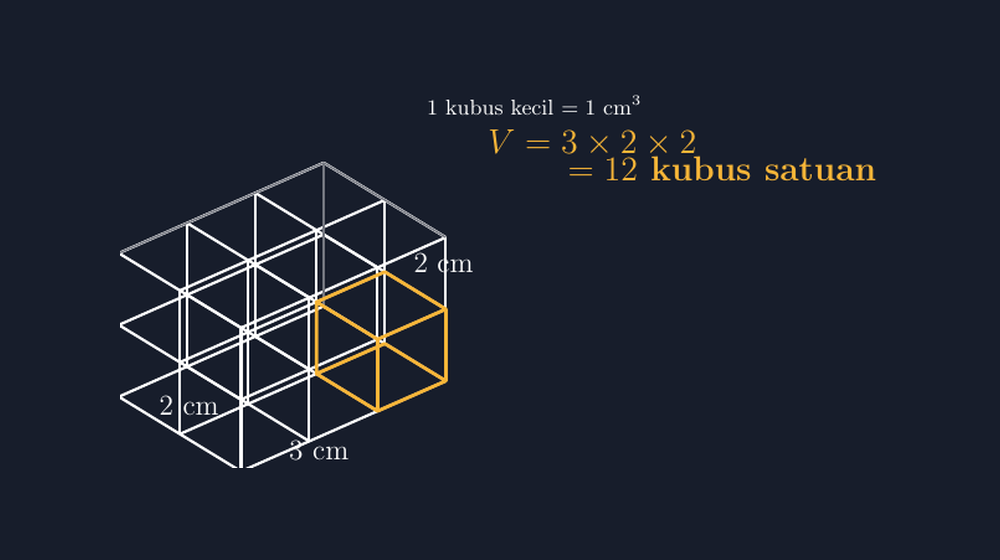

Rabu pekan lalu, di kelas VIII, saya membuka pelajaran volume balok dengan pertanyaan yang terdengar aneh: "Ada berapa kubus kecil di dalam balok ini?" Saya belum menulis satu rumus pun di papan. Anak-anak menatap gambar balok sederhana yang saya buat malam sebelumnya, lalu mulai menebak-nebak. Ada yang menjawab dua puluh, ada yang menjawab sembilan, dan satu anak di baris belakang berteriak, "Pak, baloknya kan cuma gambar, nggak kelihatan isinya!"

Dan di situlah letak masalah yang sebenarnya.

<!--more-->

Selama bertahun-tahun saya mengajarkan volume dengan pola yang sama seperti guru-guru sebelum saya: tulis rumus $V = p \times l \times t$, beri contoh angka, beri latihan, selesai. Anak-anak bisa. Nilai mereka lumayan. Tapi kalau saya tanya, "kenapa panjang dikali lebar dikali tinggi?", jawabannya zeleh-zeleh. Rumus itu bagi mereka seperti mantra yang kebetulan selalu benar, bukan sesuatu yang bisa dijelaskan dari mana asalnya.

Padahal ide di balik volume itu sederhana sekali: volume adalah banyaknya kubus satuan yang muat di dalam bangun. Kalau balok kita panjangnya 3 cm, lebarnya 2 cm, tingginya 2 cm, dan satu kubus kecilnya berrusuk 1 cm, maka isinya persis dua belas kubus. Tidak lebih, tidak kurang. Rumus $3 \times 2 \times 2$ itu bukan sihir; ia cuma cara cepat menghitung susunan yang bisa dilihat mata.

Masalahnya, menggambar susunan dua belas kubus di papan tulis dengan tangan adalah pekerjaan yang melelahkan dan hasilnya jarang meyakinkan. Garis miring sudut tiga dimensi saya selalu sedikit miring ke arah yang salah. Kubus yang seharusnya sama besar berubah jadi macam-macam ukuran. Dan anak-anak yang duduk paling pinggir justru melihat "balok" dari sudut yang paling tidak bisa dipercaya.

## Susunan kubus yang jujur

Malam itu saya duduk lagi di depan TikZ. Kali ini bukan bidang datar, tapi bangun ruang. Tantangannya beda: saya harus memilih sudut pandang (kalau istilahnya, proyeksi) yang membuat semua kubus satuan terlihat sama besar dan susunannya mudah dihitung.

Berikut gambar yang akhirnya saya pakai di kelas:



Yang saya suka dari gambar ini: satu kubus kecil saya beri garis kuning, supaya siswa paham bahwa "kubus satuan" itu bukan konsep abstrak, tapi benda nyata yang disusun berulang. Garis-garis dalam saya buat lebih tipis daripada rusuk luar, dan tiga rusuk belakang yang tersembunyi saya gambar putus-putus. Jadi matanya langsung tahu mana batas balok, mana pembagian dalamnya.

Kuncinya ada di deklarasi koordinat tiga dimensi di awal:

```latex
\begin{tikzpicture}[
  x={(0.95cm,0.42cm)}, y={(0cm,1cm)}, z={(-0.85cm,0.52cm)},
]
```

Tiga baris ini menentukan ke mana sumbu $x$, $y$, dan $z$ "menghadap" di layar. Angka-angkanya saya sesuaikan sampai proyeksinya terasa natural: sumbu $y$ tetap lurus ke atas, sumbu $x$ miring ke kanan atas, dan sumbu $z$ miring ke kiri atas. Kalau arah-arah ini salah pilih, susunan kubus akan terlihat "roboh" atau justru seperti susunan kubus datar yang dipalsukan jadi tiga dimensi.

Setelah itu, menggambar seluruh kisi-kisi balok tinggal pekerjaan `\foreach` yang rapi:

```latex
\foreach \i in {0,...,2}{ \foreach \j in {0,...,2}{ \foreach \k in {0,...,2}{
  \draw[inner] (\i,\j,\k) -- (\i+1,\j,\k); }}
```

Dan seterusnya untuk dua arah lainnya. Yang perlu diingat: loop untuk arah $y$ hanya boleh sampai 1 (karena tingginya 2 satuan, titiknya 0 dan 1), loop untuk arah $x$ sampai 2. Di sinilah saya sempat salah sendiri: loop yang saya biarkan sampai batas yang salah menghasilkan garis-garis nyasar di luar balok, persis seperti mimpi buruk di papan tulis, tapi versi digital. Untung TikZ jujur: kalau koordinatnya salah, garisnya memang akan muncul di tempat yang salah, dan saya bisa memperbaikinya sampai bersih.

## Kenapa "menghitung kubus" penting sebelum rumus

Ada satu momen kecil yang membuat saya yakin pendekatan ini layak diulang tahun depan. Setelah siswa menghitung bersama-sama ada dua belas kubus, saya tanya: "Kalau panjangnya jadi 4, ada berapa?" Mereka tidak menghitung ulang satu per satu. Mereka menambah satu kolom di depan, dan hampir seketika menjawab enam belas. "Kalau tingginya tambah satu lapis?"

Rumus $V = p \times l \times t$ akhirnya saya tulis di papan, tapi kali ini bukan sebagai pembuka, melainkan sebagai kesimpulan yang mereka temukan sendiri. Bedanya tipis di kertas, tapi besar di kepala anak.

Ini juga yang membuat gambar TikZ-nya berbeda dari sekadar ilustrasi manis. Gambar ini bisa dimodifikasi: tinggal ganti batas loop `\foreach`, dan susunan kubus berubah mengikuti dimensi baru. Guru bisa menyiapkan tiga atau empat variasi soal dari satu file yang sama, tanpa menggambar ulang dari nol. Persis seperti yang saya tulis di artikel-artikel sebelumnya: alat yang baik adalah alat yang bisa dipakai ulang tanpa membuang kerja lama.

> 📎 **Berkas TikZ lengkap:** [kubus-satuan.tex](tex/kubus-satuan.tex) — siap kompilasi (butuh paket `tikz`).

## Latihan tanpa menyiapkan kertas baru

Ada bonus kecil dari file TikZ yang mungkin lebih saya syukuri daripada gambar utamanya sendiri: variasi soal jadi murah. Dari satu file, saya bisa membuat versi balok $2 \times 2 \times 2$ untuk pemanasan, lalu $3 \times 2 \times 2$ seperti di kelas, lalu $4 \times 3 \times 2$ untuk tantangan. Batas loop `foreach` digeser, dikompilasi ulang, dan susunan kubus baru siap. Dulu, menyiapkan tiga soal susunan kubus berarti tiga kali menggambar manual dengan hasil yang belum tentu konsisten ukurannya; sekarang konsistensinya dijamin oleh koordinat yang sama.

Konsistensi ini bukan perkara kosmetik. Siswa yang melihat tiga gambar dengan proyeksi yang persis sama akan mengarahkan perhatiannya ke perubahan dimensinya, bukan ke perbedaan gaya gambar. Perhatian mereka tidak terbuang untuk hal yang tidak relevan. Bagi saya, itu inti dari bahan ajar yang baik: gambar melayani materi, bukan sebaliknya.

## Penutup: dari menghitung ke memahami

Saya tidak berpikir satu gambar bisa mengubah segalanya. Masih ada anak yang menganggap volume sebagai rutinitas angka. Tapi ada pula yang, setelah melihat susunan kubus itu, berkata pelan, "Oh, jadi rumusnya cuma cara cepat ngitung yang banyak."

Kalimat itu, bagi saya, cukup untuk satu malam mengutak-atik koordinat proyeksi di TikZ. Karena pada akhirnya tugas kita bukan membuat anak hafal rumus, tapi membuat mereka melihat bahwa rumus itu tumbuh dari sesuatu yang bisa mereka hitung sendiri, kubus demi kubus.
