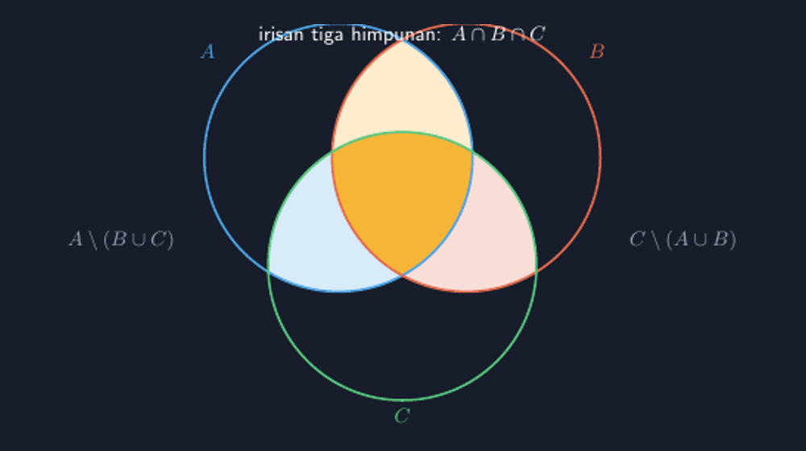

Materi himpunan di kelas VII biasanya berhenti di dua lingkaran. Dua lingkaran yang beririsan itu mudah: yang kiri himpunan $A$, yang kanan $B$, tengahnya irisan, selesai. Bahkan kalau gambar sedikit miring, anak-anak tetap paham. Tahun lalu saya menambahkan satu himpunan lagi untuk soal cerita tentang siswa yang suka matematika, suka fisika, dan suka gambar. Saya gambar diagram Venn tiga lingkaran di papan tulis, dan satu tangan cepat di baris depan langsung berkomentar: "Bu, Pak, daerah yang kuning ini masuknya yang mana?" Saya menunjuk-tunjuk papan, dan jujur saja, saya sendiri ragu apakah daerah yang saya tandai itu irisan ketiganya atau hanya irisan dua.

<!--more-->

Malam itu saya buka beberapa gambar diagram Venn tiga himpunan dari internet untuk jadi bahan lembar kerja. Yang saya temukan mengecewakan dengan cara yang halus: ada gambar yang tiga lingkarannya tidak benar-benar saling memotong di tiga daerah, ada yang daerah irisan tengahnya digambar begitu kecil sehingga tidak bisa diberi label, ada juga yang bayangannya menebal di daerah yang seharusnya tidak diarsir. Gambar seperti ini tidak langsung kelihatan salah — dan justru itu yang berbahaya. Siswa tidak akan protes. Mereka hanya akan diam-diam menyimpulkan hal yang keliru tentang daerah mana yang dimaksud "anggota ketiga himpunan sekaligus".

## Tujuh daerah, bukan dua

Diagram Venn dua himpunan punya empat daerah: hanya $A$, hanya $B$, irisan, dan di luar keduanya. Saat himpunan ketiga masuk, daerahnya melompat menjadi tujuh di dalam lingkaran, ditambah satu daerah luar. Angka tujuh ini penting untuk saya dan murid sadari: $A$ saja, $B$ saja, $C$ saja, irisan $A$ dan $B$ tapi bukan $C$, irisan $B$ dan $C$ tapi bukan $A$, irisan $A$ dan $C$ tapi bukan $B$, dan irisan ketiganya. Kalau gambar tidak menampakkan ketujuhnya dengan jelas, gambar itu gagal sebelum soalnya dibaca.

Di TikZ, ketujuh daerah itu bukan hal yang saya "perkirakan" — dia lahir sendiri dari geometri. Saya meletakkan tiga lingkaran dengan jari-jari sama di tiga pusat yang simetris:

```latex
\def\r{2.1}
\coordinate (A) at (-1.0, 0.7);
\coordinate (B) at ( 1.0, 0.7);
\coordinate (C) at ( 0.0,-1.0);
\draw[biru]  (A) circle (\r);
\draw[merah] (B) circle (\r);
\draw[hijau] (C) circle (\r);
```

Karena jari-jari ketiganya sama dan jarak antarpusatnya saya atur sama, daerah-daerah yang terbentuk dijamin simetris. Tidak ada daerah irisan yang "kebetulan" lebih besar dari yang lain. Ini hal yang tidak bisa saya janjikan kalau menggambar dengan mouse di aplikasi gambar biasa — tangan saya pasti membuat satu lingkaran sedikit lebih besar, dan siswa yang jeli akan bertanya kenapa.

## Mengarsir irisan dengan clip, bukan dengan perasaan

Bagian yang paling saya sukai adalah cara mengarsir daerah irisan. Di aplikasi gambar, orang biasanya menutupi daerah tengah dengan bentuk bebas yang disamarkan dengan lingkaran — hasilnya hampir benar, tapi "hampir" itu tetap ada. Di TikZ saya memakai logika yang sama persis dengan makna matematisnya: irisan tiga himpunan adalah daerah yang berada di dalam ketiga lingkaran sekaligus. Di TikZ, "di dalam ketiganya" diterjemahkan menjadi tiga perintah clip berurutan:

```latex
\begin{scope}
  \clip (A) circle (\r);
  \clip (B) circle (\r);
  \clip (C) circle (\r);
  \fill[aksen] (current bounding box.south west)
            rectangle (current bounding box.north east);
\end{scope}
```

Perintah `\clip` pertama membatasi gambar hanya di dalam lingkaran $A$. `\clip` kedua mempersempit lagi menjadi irisan $A$ dan $B$. `\clip` ketiga menyisakan persis irisan ketiganya. Setelah itu `\fill` mewarnai semua yang tersisa — dan yang tersisa itulah $A \cap B \cap C$. Tidak ada penilaian mata, tidak ada perkiraan. Kalau koordinatnya salah, arsirannya ikut salah, dan saya akan melihatnya sebelum gambar sampai ke tangan siswa.

Untuk daerah irisan dua himpunan tapi bukan yang ketiga, polanya sama dengan dua clip. Contoh untuk $A \cap B$ tanpa $C$:

```latex
\begin{scope}
  \clip (A) circle (\r);
  \clip (B) circle (\r);
  \fill[aksen!55] (C) circle (\r);
\end{scope}
```

Di sini triknya sedikit berbeda: setelah dua clip, saya mengisi lingkaran $C$ dengan warna aksen. Yang benar-benar terisi hanyalah bagian lingkaran $C$ yang lolos dari kedua clip — persis daerah $A \cap B \cap C$ tadi. Jadi satu gambar bisa punya beberapa tingkat kegelapan warna: makin gelap, makin banyak himpunan yang beririsan. Siswa yang buta warna sekalipun bisa membaca gradasinya.



*Tujuh daerah yang sama yang ada di kepala murid, sekarang tampak jelas di lembar kerja.*

## Dari gambar ke soal cerita

Gambar seperti ini baru bermanfaat kalau dipasangkan dengan soal yang benar-benar memakai ketujuh daerahnya. Jadi saya buat soal sederhana dari data kelas: 30 siswa, 17 suka matematika, 15 suka IPA, 14 suka gambar; 8 suka matematika dan IPA, 9 IPA dan gambar, 7 matematika dan gambar, dan 4 suka ketiganya. Pertanyaan pertama saya sengaja bukan "berapa yang suka ketiganya" — itu sudah diketahui. Pertanyaannya: berapa siswa yang tidak suka ketiga pelajaran itu?

Untuk menjawabnya, siswa harus mengisi ketujuh daerah satu per satu, mulai dari tengah (yang selalu diisi dulu), lalu daerah irisan dua, baru daerah "hanya satu". Kalau urutannya salah — misalnya mengisi daerah "suka matematika" langsung dengan 17 tanpa memperhitungkan irisan — angka akan mentok dan mereka akan sadar sendiri sebelum saya menegur. Diagram yang jujur membuat kesalahan terlihat, bukan tersembunyi. Itu sifat yang saya cari di semua media ajar saya.

## Sisa pengalaman di kelas

Kemarin gambar ini saya pakai di dua kelas VII yang berbeda. Di kelas pertama saya tampilkan diagramnya dulu, baru soal. Di kelas kedua saya suruh mereka mencoba menggambar tiga lingkaran beririsan sendiri di buku terlebih dahulu — dan hasilnya persis seperti perkiraan saya: hampir semua gambar punya daerah irisan tengah yang terlalu kecil atau lingkaran yang tidak benar-benar bertemu tiga daerah. Anak-anak tertawa melihat gambar temannya yang lingkaran ketiganya "menempel di pinggir seperti balon yang terikangkut".

Tapi justru dari situ mereka menghargai diagram yang rapi. Salah satu siswa bertanya apakah saya menggambar pakai aplikasi. Saya jawab tidak — saya mengetik koordinatnya. Dia tampak bingung, lalu berkata, "Berarti Pak bisa hitung sebelum gambar?" Ya. Dan itu, saya kira, adalah pelajaran sampingan yang lebih berharga daripada isi diagramnya sendiri: matematika dan gambar di lembar kerja bukan dua dunia yang terpisah. Gambar yang baik adalah gambar yang dihitung.

> 📎 **Berkas TikZ lengkap:** [venn-tiga-himpunan-tikz.tex](tex/venn-tiga-himpunan-tikz.tex) — siap kompilasi (butuh paket `tikz`).